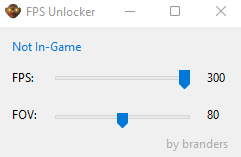

# MW2 2009 FPS and FOV Unlocker :unlock:

Tool for changing the max fps and fov for mw2 (2009) because they do not provide it.

1. Download the exe file from releases: https://github.com/andersblomqvist/mw2-fps-unlocker/releases/download/v1.3/MW2.FPS.Unlocker.exe
2. Start FPS Unlocker
3. Start MW2 through steam
4. Change sliders to your preference

Updated for September 2026

## Screenshot

## Notes

This is for MW2 released in 2009.

No recorded vac-bans. Use at your own risk.
